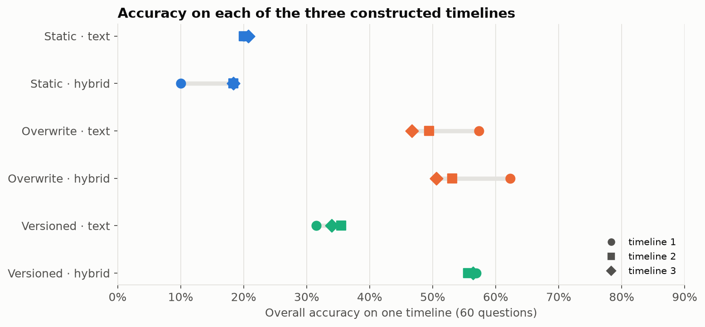

# DynMem

Dynamic episodic memory for embodied agents: answering where-and-when questions after objects move.

Which memory update policy keeps an agent's answers correct once objects move, and which retrieval design finds them?

## Results

- **Memory design decides accuracy.** With no memory the agent answers 1% of questions. The best memory setting answers 56%.
- **Static memory goes stale.** It answers 0% of "where is it now?" questions. Overwrite memory fixes that (92%) and loses history (0% on "where was it before?").
- **Hybrid search lifts versioned memory** from 34% to 56% overall, and from 40% to 90% on "what moved in a time window?".
- **Predicted trajectories cost little.** Scores with Lost & Found predictions stay within 2 percentage points of ground truth. The median placement error on test recordings is 3 cm.


*The three memory policies*


*Share of questions answered correctly, by memory setting and question type*


*Overall accuracy with 95% confidence intervals*


*Accuracy gain from hybrid search, per question type*


*Predicted versus ground-truth events, and the tracker's placement error*


*Accuracy as the position and time tolerances change*


*Tokens, tool calls and time per question*


*How often the model produced an invalid answer or a rejected tool call*



*Accuracy on each constructed timeline*


*Effect of the single dev tuning round*


Tables with confidence intervals and paired tests: [`figures/tables_test.md`](figures/tables_test.md). Every figure is built from the traces in `results/`.
Reports: [`REPORT.md`](REPORT.md), [`SUMMARY.md`](SUMMARY.md). Deviations from the plan: [`DEVIATIONS.md`](DEVIATIONS.md). Costs: [`COSTS.md`](COSTS.md).

## Setup

- **Data:** Lost & Found, 96 egocentric pick-and-place recordings of 9 objects in one scene. Recordings are placed on constructed timelines with random 3 to 20 minute gaps.
- **Memory policies:** static (initial scan), overwrite (latest pose), versioned (append-only with validity intervals).
- **Retrieval:** text search only, or hybrid (time, position and object filters, per-object history).
- **Questions:** five templated types, scored deterministically. Position within 0.25 m, time within 10 s, count exact, interval by F1.
- **Agent:** `qwen2.5:7b` with tool calling, at most 3 retrieval rounds, strict JSON answers.
- **Splits:** by recording. 27 dev, 69 test. Prompts and tolerances were tuned on dev and frozen before the test run.
- **Test set:** 3 timelines, 180 questions per setting, ground-truth and predicted events.

## Reproduce

```
uv venv --python 3.11 .venv && uv pip install -e ".[dev]"
make test      # unit tests
make data      # scan archive and per-recording files (about 440 MB transferred)
make stage_b   # needs a running Ollama server with qwen2.5:7b
make report    # figures, tables, README, SUMMARY, REPORT
```

API keys are read from environment variables only. The default agent runs locally.

## Limitations

- Timelines are constructed from independent recordings. They are not a continuous real-world log.
- One scene, nine objects, three timelines.
- Each object starts every recording from nearly the same pose, so the previous location is usually the initial scan pose. "Where was it before?" does not separate static memory from the others, and the figures also show scores without it.
- The agent is a local 7B model. Frontier models would score higher in absolute terms.
- Position and time tolerances were chosen on the dev split. Figure 05 shows how scores change with them.
- The agent was not validated against published ReMEmbR results (NaVQA and CODa are not included).
- No robot hardware is used.

## Data and licenses

| Dataset | Use | License |
|---|---|---|
| Lost & Found (Zenodo 14967441, arXiv 2411.19162) | trajectories | CC BY 4.0 |

Code: MIT ([`LICENSE`](LICENSE)). No dataset files are stored in this repository.
