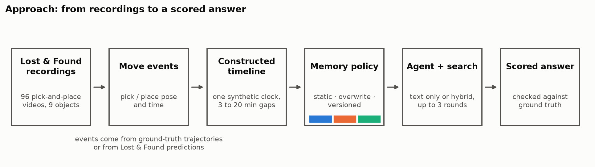
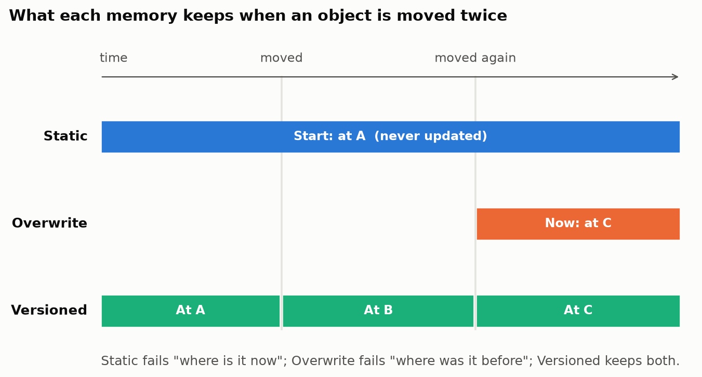
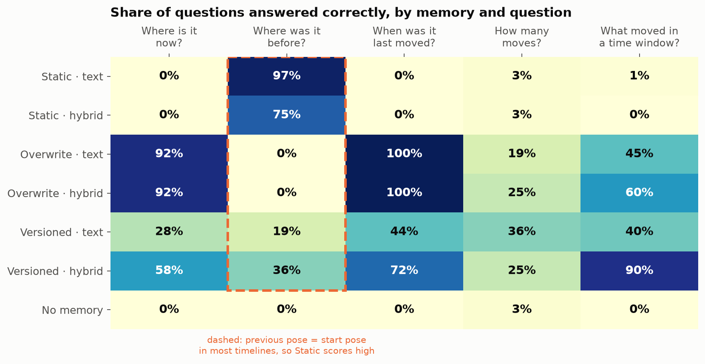
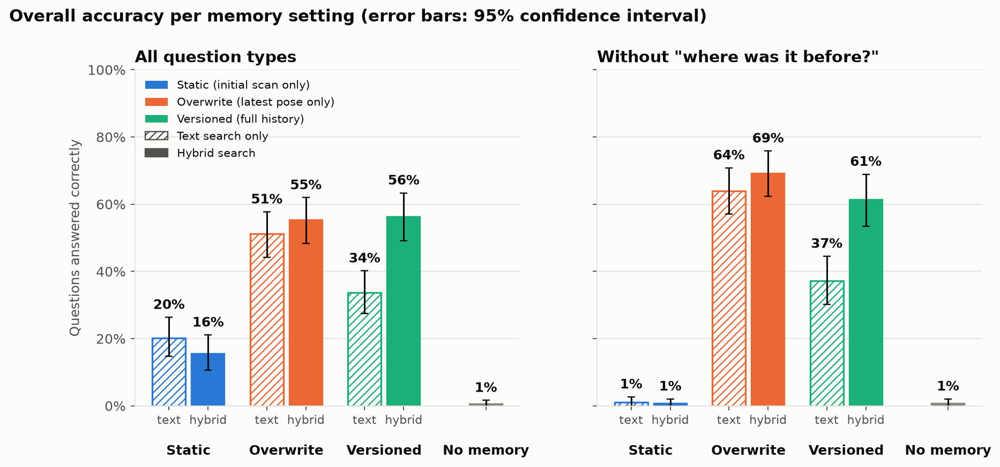
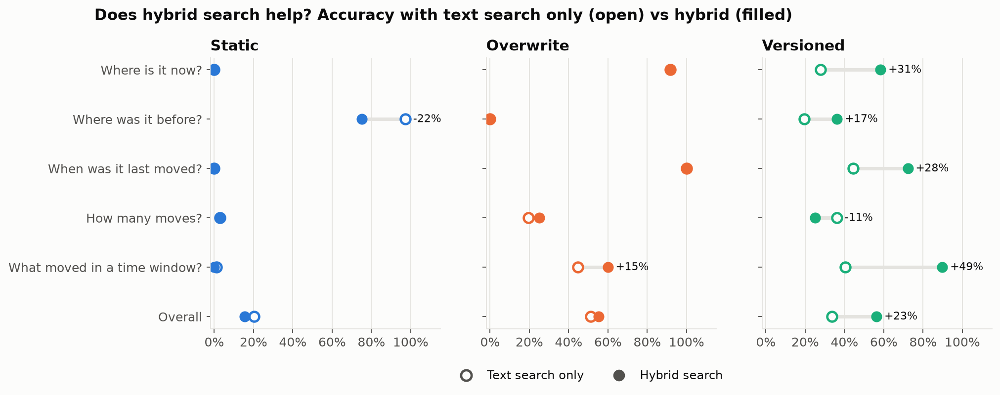
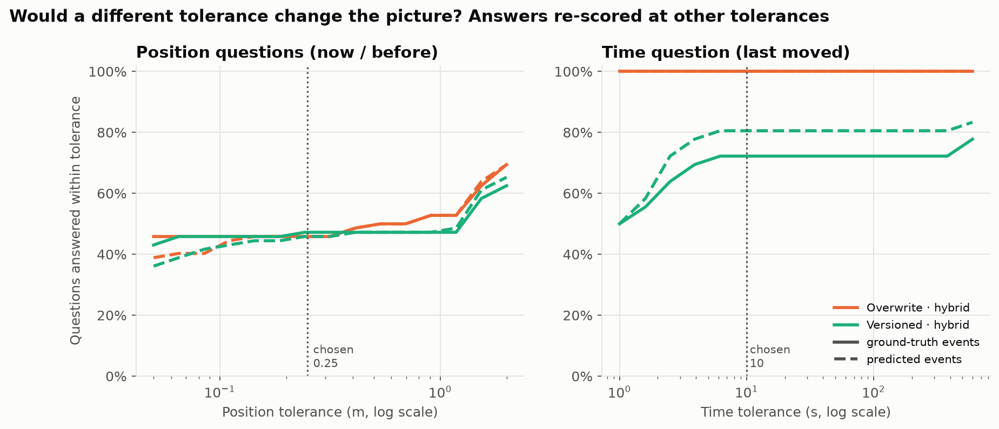
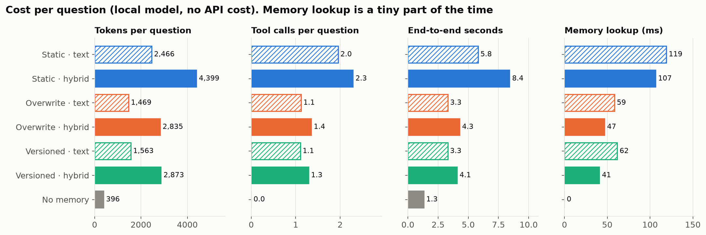
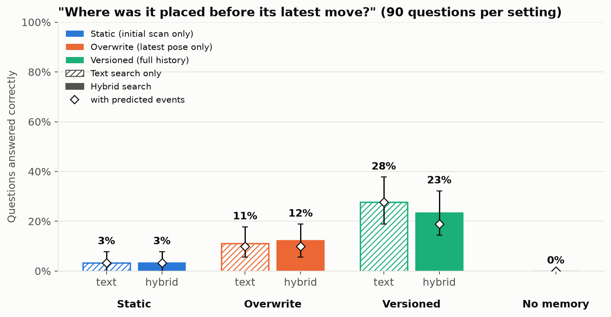

# DynMem

Dynamic episodic memory for embodied agents: answering where-and-when questions after objects move.

## Summary

This project measures how the long-term memory of an embodied agent should be updated and searched when objects move. It builds a retrieval-augmented memory agent and tests three memory update policies and two retrieval designs on 96 real pick-and-place recordings from the Lost & Found dataset. Without memory the agent answers 1% of where-and-when questions. The best memory setting answers 56%. Each simpler policy fails one question class: a static memory cannot say where an object is now (0%), and an overwrite memory cannot say where it was before (0%). Hybrid search lifts a versioned memory from 34% to 56%. Noise from predicted trajectories costs at most 2 percentage points. Work in progress is tracked in the [roadmap](#roadmap).

## Problem

A robot or a pair of smart glasses can keep a long-term memory of what it saw. A common design captions short video segments, embeds the captions and stores them in a vector database with position and time. An LLM agent then answers questions through retrieval tools. ReMEmbR (arXiv 2409.13682) is a reference system of this kind.

Such a memory records what was seen once. Objects move. A question like "where is the mug now?" then has an answer that the stored observation no longer holds. Lost & Found (arXiv 2411.19162) tracks the 6DoF pose of objects that a person moves, which makes the changes observable.

This study asks three questions:

1. **Update policy.** Which memory update policy keeps answers correct after objects move: static, overwrite or versioned?
2. **Retrieval design.** Does a hybrid search (text, time, position and object filters, per-object history) beat text search alone?
3. **Perception noise.** How much accuracy is lost when the memory is built from predicted trajectories instead of ground-truth ones?

## Approach



*From recordings to a scored answer*

- **Events.** Each recording is one pick-and-place. A speed threshold gives the pick pose, the place pose and the times. Events come from ground-truth trajectories or from Lost & Found predictions.
- **Timelines.** The 96 recordings are independent. They are placed on one synthetic clock with random 3 to 20 minute gaps, in an order set by a fixed seed. Timelines are constructed and not a real continuous log.
- **Memory policies.** Static keeps the initial scan. Overwrite keeps one entry per object and replaces it on each move. Versioned appends entries with validity intervals.
- **Retrieval designs.** Text-only search, or hybrid search with time, position and object filters and a per-object history tool.
- **Agent.** `qwen2.5:7b` with tool calling, at most 3 retrieval rounds and strict JSON answers. A parse failure scores 0. Every call is cached and run at temperature 0.
- **Questions.** Five templated types: where now, where before, when last moved, how many moves, what moved in a time window. Scoring is deterministic: position within 0.25 m, time within 10 s, count exact, interval by F1.
- **Splits.** By recording: 27 dev, 69 test. Prompts and tolerances were tuned on dev and frozen before the test run. The test set holds 3 timelines and 180 questions per setting.

## Results

- **Memory design decides accuracy.** With no memory the agent answers 1% of questions. The best memory setting answers 56%.
- **Static memory goes stale.** It answers 0% of "where is it now?" questions. Overwrite memory fixes that (92%) and loses history (0% on "where was it before?").
- **Hybrid search lifts versioned memory** from 34% to 56% overall, and from 40% to 90% on "what moved in a time window?".
- **Predicted trajectories cost little.** Scores with Lost & Found predictions stay within 2 percentage points of ground truth. The median placement error on test recordings is 3 cm.
- **Only versioned memory answers the history question.** On "where was it placed before its latest move?" versioned memory answers 28% with text search and 23% with hybrid search. Static and overwrite memory answer at most 12%.



*The three memory policies*



*Share of questions answered correctly, by memory setting and question type*



*Overall accuracy with 95% confidence intervals*



*Accuracy gain from hybrid search, per question type*


*Predicted versus ground-truth events, and the tracker's placement error*



*Accuracy as the position and time tolerances change*



*Tokens, tool calls and time per question*


*How often the model produced an invalid answer or a rejected tool call*


*Accuracy on each constructed timeline*


*Effect of the single dev tuning round*



*The history question: where was the object placed before its latest move?*

Tables with confidence intervals and paired tests: [`figures/tables_test.md`](figures/tables_test.md). Every figure is built from the traces in `results/`.
Reports: [`REPORT.md`](REPORT.md), [`SUMMARY.md`](SUMMARY.md). Deviations from the plan: [`DEVIATIONS.md`](DEVIATIONS.md). Costs: [`COSTS.md`](COSTS.md).

## Conclusions

- **History is needed, and each simpler policy fails one question class.** Static memory cannot answer "now" (0%). Overwrite memory cannot answer "before" (0%).
- **Hybrid retrieval matters most when memory holds many versions.** For versioned memory the paired gain is +0.28 (McNemar p = 2.2e-08). For overwrite memory it is smaller.
- **Versioned and overwrite memory are level overall with this model.** 56% against 55% (paired p = 0.27). Versioned memory is stronger on time-window questions (90% against 60%). It is weaker on "where is it now?" (58% against 92%). In 12 of its 15 failures on that question the model had retrieved entries of the right object and still gave a wrong position. In 3 it gave no position.
- **Keeping history pays off on the question that needs it.** Versioned memory answers 28% against at most 12% for the other policies (paired p = 0.0081, 90 questions). Hybrid search did not help on this question (23% hybrid against 28% text, paired p = 0.61). Overwrite memory gets 10 of its 11 correct answers only where the object was placed twice at the same spot.
- **Perception noise is not the bottleneck here.** Median placement error is 3 cm, well inside the 0.25 m tolerance. A tolerance sweep (figure 05) shows the same picture at other tolerances.

| Hypothesis | Outcome |
|---|---|
| H1. A rebuilt ReMEmbR-style agent matches published correctness | Not tested. The NaVQA validation was not run. |
| H2. Static fails "now", overwrite fails "before", versioned answers both | The first two held. On the history question versioned memory answers 28% against at most 12% for the other policies. |
| H3. Hybrid retrieval helps most on temporal questions | Held for versioned memory. Smaller effect for overwrite memory. |
| H4. Predicted trajectories lower accuracy only slightly | Held. Largest gap 2 percentage points. |

## Roadmap

- [x] Memory store, retrieval tools, tool-calling agent and deterministic scoring
- [x] Three memory policies and two retrieval designs on Lost & Found, with ground-truth and predicted events
- [x] Dev/test split by recording, frozen prompts, confidence intervals and paired tests
- [x] Figures and tables generated from result files
- [x] A history question that only versioned memory can answer ("where was it placed before its latest move?")
- [ ] Remove the text-tool confound: let text-only search accept an object argument
- [ ] Repeat the key settings with a stronger model (Gemini)
- [ ] Chained timelines, so each move starts where the previous one ended
- [ ] Larger test set: 5 timelines and 150 questions per timeline
- [ ] Paper-style report (PDF, about 4 pages)
- [ ] Validate the agent on NaVQA against published ReMEmbR results
- [ ] Memory budget ablation: limit the number of entries and test an eviction policy

## Reproduce

```
uv venv --python 3.11 .venv && uv pip install -e ".[dev]"
make test      # unit tests
make data      # scan archive and per-recording files (about 440 MB transferred)
make stage_b   # needs a running Ollama server with qwen2.5:7b
make report    # figures, tables, README, SUMMARY, REPORT
```

API keys are read from environment variables only. The default agent runs locally.

## Limitations

- Timelines are constructed from independent recordings. They are not a continuous real-world log.
- One scene, nine objects, three timelines.
- Each object starts every recording from nearly the same pose, so the previous location is usually the initial scan pose. "Where was it before?" does not separate static memory from the others, and the figures also show scores without it.
- The agent is a local 7B model. Frontier models would score higher in absolute terms.
- In the text-only design the model often passed an `object` filter that `search_text` does not accept. The tool returned an error and the model retried. This may understate text-only accuracy.
- Position and time tolerances were chosen on the dev split. Figure 05 shows how scores change with them.
- The agent was not validated against published ReMEmbR results (NaVQA and CODa are not included).
- No robot hardware is used.

## Resources

**Data**

| Resource | Size | Used for | License |
|---|---|---|---|
| [Lost & Found dataset](https://zenodo.org/records/14967441), [`Final_Dataset.zip`](https://zenodo.org/records/14967441/files/Final_Dataset.zip?download=1) | 30.2 GB | object trajectories, ICP transforms | CC BY 4.0 |
| [Lost & Found scan](https://zenodo.org/records/14967441), [`Final_Scan.zip`](https://zenodo.org/records/14967441/files/Final_Scan.zip?download=1) | 434 MB | scene point cloud, coordinate check | CC BY 4.0 |

`make data` downloads the scan and fetches only the six small files per recording (about 4 MB in total) from the 30 GB archive by HTTP range requests. The raw `.vrs` videos are not needed.

**Papers and code**

- Lost & Found: Tracking Changes from Egocentric Observations in 3D Dynamic Scene Graphs. [arXiv 2411.19162](https://arxiv.org/abs/2411.19162), [code](https://github.com/behretj/LostFound).
- ReMEmbR: Building and Reasoning Over Long-Horizon Spatio-Temporal Memory for Robot Navigation. [arXiv 2409.13682](https://arxiv.org/abs/2409.13682), [code](https://github.com/NVIDIA-AI-IOT/remembr).

**Models**

| Model | Role |
|---|---|
| [`qwen2.5:7b`](https://ollama.com/library/qwen2.5) (Q4_K_M, via Ollama) | agent for all reported results |
| [`mixedbread-ai/mxbai-embed-large-v1`](https://huggingface.co/mixedbread-ai/mxbai-embed-large-v1) | text embeddings for the memory store |
| [`qwen3.5:9b`](https://ollama.com/library/qwen3.5) | tried, not used: 14 GB resident on a 24 GB laptop |
| `gemini-3.5-flash` | tool-calling test only: the free tier allows 5 requests per minute |

**Software**

[Ollama](https://ollama.com) for local inference, [Qdrant](https://qdrant.tech/documentation/) in local mode as the memory store, [sentence-transformers](https://sbert.net) for embeddings, [uv](https://docs.astral.sh/uv/) for the environment.

Code: MIT ([`LICENSE`](LICENSE)). No dataset files are stored in this repository.
